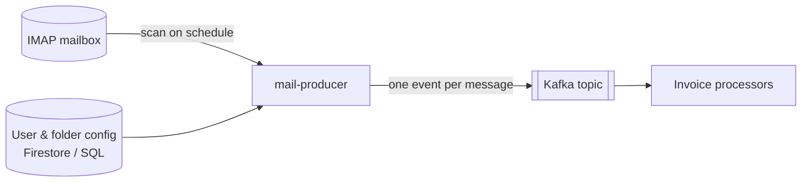

# InvoiceWatcher

InvoiceWatcher watches your mailboxes and turns incoming e-mails into events, so invoices can be
picked up and processed automatically — no more digging through folders at the end of the month.

## Where to start

| You want to… | Go to |
|--------------|-------|
| Understand how it works and how it is built | [System](system/index.md) |
| Set it up yourself, from cloud accounts to a running environment | [Setup](setup/index.md) |
| Run it on your machine and contribute | [Local development](setup/local.md) |
| See what it produces | [In action](results/index.md) |
| Look up a property, command or module | [Reference](reference/index.md) |
