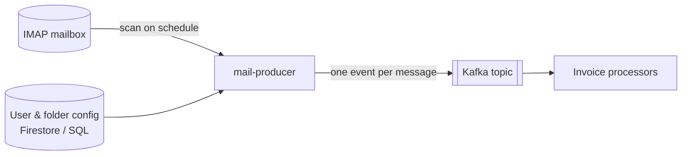

# InvoiceWatcher

InvoiceWatcher watches your mailboxes and turns incoming e-mails into events, so invoices can be
picked up and processed automatically — no more digging through folders at the end of the month.

## Where to start

| You want to… | Go to |
|--------------|-------|
| Connect a mailbox and choose folders to watch | [User guide](guide/index.md) |
| Deploy and run InvoiceWatcher | [Operations](operate/index.md) |
| Build, run locally and contribute | [Development](develop/index.md) |
| Know exactly how a feature behaves | [Specifications](specs/index.md) |
| Understand why it is built this way | [Decisions](adr/index.md) |
| Look up a property or command | [Reference](reference/index.md) |
