<!-- Generated by scripts/gen-reference.py - do not edit, run scripts/verify.sh -->

# Modules

Gradle modules, registered automatically from every directory under `apps/`, `images/`
and `libs/` that contains a `build.gradle.kts`.

| Module | Directory | Description |
|---|---|---|
| `:apps:mail-producer-app` | `apps/mail-producer-app` | Spring Boot application that scans mailboxes on a schedule and publishes their messages as events. |
| `:apps:secret-helper-app` | `apps/secret-helper-app` | Command-line tool that generates AES keys and encrypts and decrypts secrets. |
| `:apps:user-registration-backend-app` | `apps/user-registration-backend-app` | Registration backend with Google sign-in and Gmail OAuth. |
| `:apps:user-registration-frontend-app` | `apps/user-registration-frontend-app` | Angular registration frontend consuming the shared component and design-token library. |
| `:frontend` | `frontend` | Shared frontend toolchain, pnpm installation, UI library and catalogue. |
| `:images:mail-producer-docker` | `images/mail-producer-docker` | Docker image of the mail producer application. |
| `:images:user-registration-backend-docker` | `images/user-registration-backend-docker` | Docker image of the registration backend application. |
| `:images:user-registration-frontend-docker` | `images/user-registration-frontend-docker` | Docker image of the registration frontend application. |
| `:libs:attachment-storage-api` | `libs/attachment-storage/api` | Private immutable attachment storage contracts. |
| `:libs:attachment-storage-filesystem-impl` | `libs/attachment-storage/filesystem-impl` | Private local attachment files with immutable generations and expiry cleanup. |
| `:libs:attachment-storage-gcs-impl` | `libs/attachment-storage/gcs-impl` | Generation-pinned private attachment storage in Google Cloud Storage. |
| `:libs:dao-event-processing-api` | `libs/dao/event-processing/api` | Processing state and recovery contracts. |
| `:libs:dao-event-processing-firestore-impl` | `libs/dao/event-processing/firestore-impl` | Durable processing state in Firestore in Datastore mode. |
| `:libs:dao-event-processing-jpa-impl` | `libs/dao/event-processing/jpa-impl` | Isolated JPA persistence for processing lifecycle, outbox and replay with local H2 support. |
| `:libs:dao-mail-attachment-api` | `libs/dao/mail-attachment/api` | Durable application-user scoped attachment capture reservations. |
| `:libs:dao-mail-attachment-firestore-impl` | `libs/dao/mail-attachment/firestore-impl` | Transactional attachment capture state in Firestore Datastore mode. |
| `:libs:dao-mail-attachment-jpa-impl` | `libs/dao/mail-attachment/jpa-impl` | Isolated JPA persistence for attachment captures with local H2 support. |
| `:libs:dao-user-configuration-api` | `libs/dao/user-configuration/api` | Storage interfaces for users, mailbox configurations and folders. |
| `:libs:dao-user-configuration-firestore-impl` | `libs/dao/user-configuration/firestore-impl` | Storage of users in Firestore in Datastore mode. |
| `:libs:dao-user-configuration-jpa-impl` | `libs/dao/user-configuration/jpa-impl` | Storage of users in a relational database via JPA (H2 or Cloud SQL). |
| `:libs:event-processor-api` | `libs/event-processor/api` | Contracts for idempotent event processing and controlled replay. |
| `:libs:event-processor-impl` | `libs/event-processor/impl` | Shared processing lifecycle, outbox and replay services. |
| `:libs:event-processor-kafka-impl` | `libs/event-processor/kafka-impl` | Kafka transport and managed consumers for event processors. |
| `:libs:event-producer-api` | `libs/event-producer/api` | Event producer interface and backend selection. |
| `:libs:event-producer-kafka-impl` | `libs/event-producer/kafka-impl` | Event producer that sends events to Kafka. |
| `:libs:mail-attachment-api` | `libs/mail-attachment/api` | Attachment evidence, capture policy and bounded MIME source interfaces. |
| `:libs:mail-attachment-impl` | `libs/mail-attachment/impl` | Bounded attachment capture, replay access and expiry orchestration. |
| `:libs:mail-connector-api` | `libs/mail-connector/api` | Mailbox connection interfaces: connections, queries, messages, credentials. |
| `:libs:mail-connector-impl` | `libs/mail-connector/impl` | IMAP mailbox connection based on Angus Mail, scanning folders by UID. |
| `:libs:mail-producer-mock-user` | `libs/mail-producer/mock/user` | Creates a mock user from properties at startup. |
| `:libs:mail-producer-scheduler-api` | `libs/mail-producer/scheduler/api` | Interface of the scheduled mail producer task. |
| `:libs:mail-producer-scheduler-impl` | `libs/mail-producer/scheduler/impl` | Runs the mail producer task at a fixed rate. |
| `:libs:mail-producer-task` | `libs/mail-producer/task` | Scan task: reads users, scans their folders and publishes new messages. |
| `:libs:oauth-google-api` | `libs/oauth/google/api` | Google OAuth contracts and validated client settings. |
| `:libs:oauth-google-impl` | `libs/oauth/google/impl` | Google OAuth grant refresh and revocation with bounded network requests. |
| `:libs:secret-aes` | `libs/secret/aes` | AES-GCM implementation of secrets, decrypted only when used. |
| `:libs:secret-api` | `libs/secret/api` | Secret value interface and factory. |
| `:libs:testing-testcontainers` | `libs/testing/testcontainers` | Test-only container image pins and isolated Kafka and Datastore fixtures. |
| `:libs:user-registration-api` | `libs/user-registration/api` | Registration contracts and public origin settings. |
| `:libs:user-registration-impl` | `libs/user-registration/impl` | Google sign-in, Gmail consent and owner-scoped registration HTTP API. |
| `:libs:util-aes` | `libs/util/aes` | AES-GCM encryption, decryption and key encoding helpers. |

## Dependencies

Click the diagram to enlarge it.

```mermaid
---
config:
  layout: elk
---
flowchart TB
  subgraph images
    images_mail_producer_docker["mail-producer-docker"]
    images_user_registration_backend_docker["user-registration-backend-docker"]
    images_user_registration_frontend_docker["user-registration-frontend-docker"]
  end
  subgraph apps
    apps_mail_producer_app["mail-producer-app"]
    apps_secret_helper_app["secret-helper-app"]
    apps_user_registration_backend_app["user-registration-backend-app"]
    apps_user_registration_frontend_app["user-registration-frontend-app"]
  end
  subgraph impl
    libs_attachment_storage_filesystem_impl["attachment-storage-filesystem-impl"]
    libs_attachment_storage_gcs_impl["attachment-storage-gcs-impl"]
    libs_dao_event_processing_firestore_impl["dao-event-processing-firestore-impl"]
    libs_dao_event_processing_jpa_impl["dao-event-processing-jpa-impl"]
    libs_dao_mail_attachment_firestore_impl["dao-mail-attachment-firestore-impl"]
    libs_dao_mail_attachment_jpa_impl["dao-mail-attachment-jpa-impl"]
    libs_dao_user_configuration_firestore_impl["dao-user-configuration-firestore-impl"]
    libs_dao_user_configuration_jpa_impl["dao-user-configuration-jpa-impl"]
    libs_event_processor_impl["event-processor-impl"]
    libs_event_processor_kafka_impl["event-processor-kafka-impl"]
    libs_event_producer_kafka_impl["event-producer-kafka-impl"]
    libs_mail_attachment_impl["mail-attachment-impl"]
    libs_mail_connector_impl["mail-connector-impl"]
    libs_mail_producer_mock_user["mail-producer-mock-user"]
    libs_mail_producer_scheduler_impl["mail-producer-scheduler-impl"]
    libs_mail_producer_task["mail-producer-task"]
    libs_oauth_google_impl["oauth-google-impl"]
    libs_secret_aes["secret-aes"]
    libs_testing_testcontainers["testing-testcontainers"]
    libs_user_registration_impl["user-registration-impl"]
    libs_util_aes["util-aes"]
  end
  subgraph api
    libs_attachment_storage_api["attachment-storage-api"]
    libs_dao_event_processing_api["dao-event-processing-api"]
    libs_dao_mail_attachment_api["dao-mail-attachment-api"]
    libs_dao_user_configuration_api["dao-user-configuration-api"]
    libs_event_processor_api["event-processor-api"]
    libs_event_producer_api["event-producer-api"]
    libs_mail_attachment_api["mail-attachment-api"]
    libs_mail_connector_api["mail-connector-api"]
    libs_mail_producer_scheduler_api["mail-producer-scheduler-api"]
    libs_oauth_google_api["oauth-google-api"]
    libs_secret_api["secret-api"]
    libs_user_registration_api["user-registration-api"]
  end
  apps_mail_producer_app --> libs_attachment_storage_filesystem_impl
  apps_mail_producer_app --> libs_attachment_storage_gcs_impl
  apps_mail_producer_app --> libs_dao_mail_attachment_firestore_impl
  apps_mail_producer_app --> libs_dao_mail_attachment_jpa_impl
  apps_mail_producer_app --> libs_dao_user_configuration_firestore_impl
  apps_mail_producer_app --> libs_dao_user_configuration_jpa_impl
  apps_mail_producer_app --> libs_event_producer_kafka_impl
  apps_mail_producer_app --> libs_mail_attachment_impl
  apps_mail_producer_app --> libs_mail_connector_impl
  apps_mail_producer_app --> libs_mail_producer_mock_user
  apps_mail_producer_app --> libs_mail_producer_scheduler_impl
  apps_mail_producer_app --> libs_mail_producer_task
  apps_mail_producer_app --> libs_oauth_google_impl
  apps_mail_producer_app --> libs_secret_aes
  apps_secret_helper_app --> libs_util_aes
  apps_user_registration_backend_app --> libs_dao_user_configuration_firestore_impl
  apps_user_registration_backend_app --> libs_dao_user_configuration_jpa_impl
  apps_user_registration_backend_app --> libs_oauth_google_impl
  apps_user_registration_backend_app --> libs_secret_aes
  apps_user_registration_backend_app --> libs_user_registration_impl
  images_mail_producer_docker --> apps_mail_producer_app
  images_user_registration_backend_docker --> apps_user_registration_backend_app
  images_user_registration_frontend_docker --> apps_user_registration_frontend_app
  libs_attachment_storage_filesystem_impl --> libs_attachment_storage_api
  libs_attachment_storage_filesystem_impl --> libs_mail_attachment_api
  libs_attachment_storage_gcs_impl --> libs_attachment_storage_api
  libs_attachment_storage_gcs_impl --> libs_mail_attachment_api
  libs_dao_event_processing_firestore_impl --> libs_dao_event_processing_api
  libs_dao_event_processing_jpa_impl --> libs_dao_event_processing_api
  libs_dao_event_processing_jpa_impl --> libs_secret_api
  libs_dao_mail_attachment_api --> libs_mail_attachment_api
  libs_dao_mail_attachment_firestore_impl --> libs_dao_mail_attachment_api
  libs_dao_mail_attachment_jpa_impl --> libs_dao_mail_attachment_api
  libs_dao_mail_attachment_jpa_impl --> libs_secret_api
  libs_dao_user_configuration_api --> libs_mail_connector_api
  libs_dao_user_configuration_firestore_impl --> libs_dao_user_configuration_api
  libs_dao_user_configuration_jpa_impl --> libs_dao_user_configuration_api
  libs_event_processor_api --> libs_event_producer_api
  libs_event_processor_impl --> libs_dao_event_processing_api
  libs_event_processor_impl --> libs_event_processor_api
  libs_event_processor_kafka_impl --> libs_event_processor_api
  libs_event_producer_kafka_impl --> libs_event_producer_api
  libs_mail_attachment_api --> libs_attachment_storage_api
  libs_mail_attachment_impl --> libs_dao_mail_attachment_api
  libs_mail_attachment_impl --> libs_mail_attachment_api
  libs_mail_connector_api --> libs_mail_attachment_api
  libs_mail_connector_api --> libs_secret_api
  libs_mail_connector_impl --> libs_mail_connector_api
  libs_mail_producer_mock_user --> libs_dao_user_configuration_api
  libs_mail_producer_mock_user --> libs_secret_api
  libs_mail_producer_scheduler_impl --> libs_mail_producer_scheduler_api
  libs_mail_producer_task --> libs_dao_user_configuration_api
  libs_mail_producer_task --> libs_event_producer_api
  libs_mail_producer_task --> libs_mail_connector_api
  libs_mail_producer_task --> libs_mail_producer_scheduler_api
  libs_oauth_google_api --> libs_dao_user_configuration_api
  libs_oauth_google_impl --> libs_oauth_google_api
  libs_secret_aes --> libs_secret_api
  libs_secret_aes --> libs_util_aes
  libs_user_registration_api --> libs_oauth_google_api
  libs_user_registration_impl --> libs_user_registration_api
```

