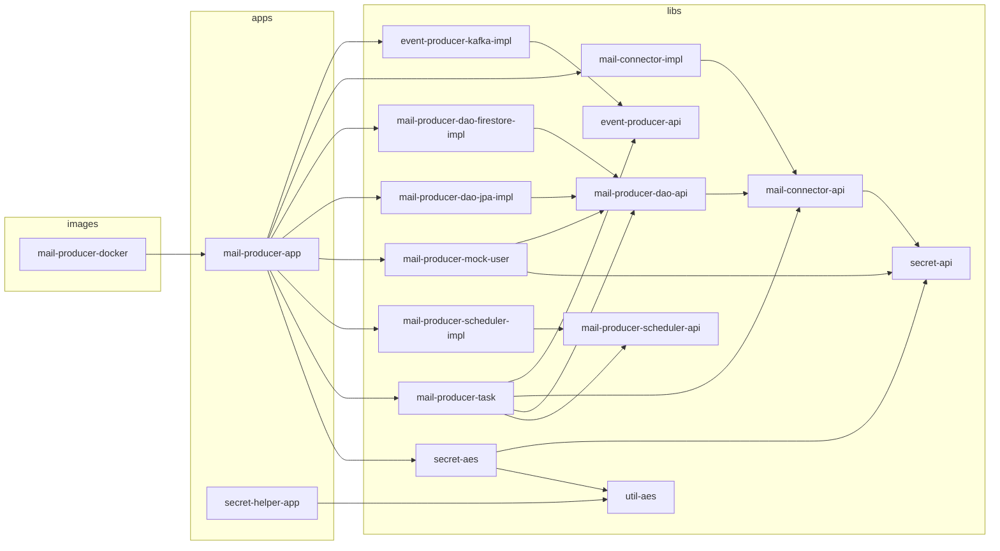

<!-- Generated by scripts/gen-reference.py - do not edit, run scripts/verify.sh -->

# Modules

Gradle modules, registered automatically from every directory under `apps/`, `images/`
and `libs/` that contains a `build.gradle.kts`.

| Module | Directory | Description |
|---|---|---|
| `:apps:mail-producer-app` | `apps/mail-producer-app` | Spring Boot application that scans mailboxes on a schedule and publishes their messages as events. |
| `:apps:secret-helper-app` | `apps/secret-helper-app` | Command-line tool that generates AES keys and encrypts and decrypts secrets. |
| `:images:mail-producer-docker` | `images/mail-producer-docker` | Docker image of the mail producer application. |
| `:libs:event-producer-api` | `libs/event-producer/api` | Event producer interface and backend selection. |
| `:libs:event-producer-kafka-impl` | `libs/event-producer/kafka-impl` | Event producer that sends events to Kafka. |
| `:libs:mail-connector-api` | `libs/mail-connector/api` | Mailbox connection interfaces: connections, queries, messages, credentials. |
| `:libs:mail-connector-impl` | `libs/mail-connector/impl` | IMAP mailbox connection based on Jakarta Mail, with date-based message search. |
| `:libs:mail-producer-dao-api` | `libs/mail-producer/dao/api` | Storage interfaces for users, mailbox configurations and folders. |
| `:libs:mail-producer-dao-firestore-impl` | `libs/mail-producer/dao/firestore-impl` | Storage of users in Firestore in Datastore mode. |
| `:libs:mail-producer-dao-jpa-impl` | `libs/mail-producer/dao/jpa-impl` | Storage of users in a relational database via JPA (H2 or Cloud SQL). |
| `:libs:mail-producer-mock-user` | `libs/mail-producer/mock/user` | Creates a mock user from properties at startup. |
| `:libs:mail-producer-scheduler-api` | `libs/mail-producer/scheduler/api` | Interface of the scheduled mail producer task. |
| `:libs:mail-producer-scheduler-impl` | `libs/mail-producer/scheduler/impl` | Runs the mail producer task at a fixed rate. |
| `:libs:mail-producer-task` | `libs/mail-producer/task` | Scan task: reads users, scans their folders and publishes new messages. |
| `:libs:secret-aes` | `libs/secret/aes` | AES-GCM implementation of secrets, decrypted only when used. |
| `:libs:secret-api` | `libs/secret/api` | Secret value interface and factory. |
| `:libs:util-aes` | `libs/util/aes` | AES-GCM encryption, decryption and key encoding helpers. |

## Dependencies

