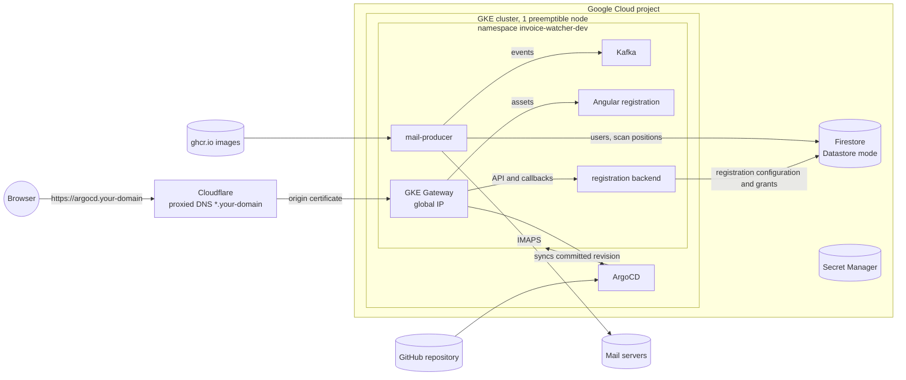
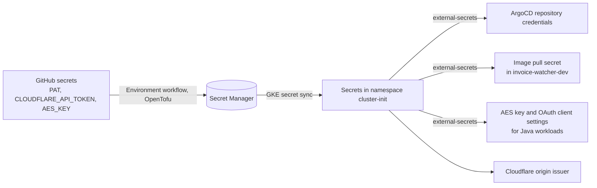
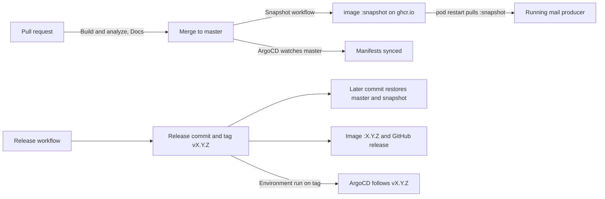

# Architecture

## Applications and libraries

The backend services use Java 25 and Spring Boot 4; the registration frontend is a separate Angular
application. Runnable modules and their dependencies are listed in the generated
[module reference](../reference/modules.md), rather than maintained as a second inventory here.

The applications contain almost no code — they put libraries together. Each library area has an
`api` module with interfaces, records and configuration properties, and one or more
implementations that plug themselves in through Spring Boot auto-configuration. Where there is a choice, a
`mode` property picks the implementation:

| Area | Implementations | Selected by |
|------|-----------------|-------------|
| Storage of users | Firestore (Datastore mode), JPA (H2, Cloud SQL) | [`invoice-watcher.user-configuration.dao.mode`](../reference/configuration.md#invoice-watcher-user-configuration-dao) |
| Events | Kafka | [`invoice-watcher.event-producer.mode`](../reference/configuration.md#invoice-watcher-event-producer) |
| Mailbox access | IMAP (Jakarta Mail) | — |
| Secrets | AES-GCM | — |

The full list of modules and their dependencies is generated in [Modules](../reference/modules.md).

## Runtime

In the deployed environment everything runs in one Google Cloud project and one GKE cluster:

- **Cloudflare** holds the domain. A proxied wildcard record points at the gateway's global IP,
  and the gateway serves HTTPS with a Cloudflare origin certificate issued in the cluster.
- **ArgoCD** is available at `https://argocd.<domain>`. Registration is available at
  `https://register.<domain>`; the mail producer has no public HTTP interface.
- **Kafka** runs as a single node inside the cluster. Its data is kept on a persistent disk, so
  events survive restarts of the Kafka pod and replacement of the preemptible node; the disk is
  deleted together with the environment.
- **Firestore** keeps users, mailboxes, folders and scan positions. The mail producer reaches it
  through workload identity, so there are no service account keys.

### How secrets reach the cluster

No secret is stored in the repository.
The GitHub token, the Cloudflare token, the AES key and Google OAuth client settings are given to the `Environment` workflow as GitHub
secrets; OpenTofu stores them in Secret Manager, and the cluster pulls them from there:

## Delivery

- **Pull requests** are built and tested (`./gradlew build analyze`: tests, Checkstyle,
  SpotBugs), the generated reference pages are checked to be up to date, and changes under
  `deployments/` are checked for formatting, validity and rendering. A failure blocks the merge.
- **Every merge to `master`** that touches more than documentation publishes the image
  `ghcr.io/<owner>/<repository>/mail-producer:snapshot`, replacing the previous one.
- **The `Release` workflow**, run by hand with `major`, `minor` or `patch`, tags the commit
  `v<version>`, publishes the image tagged `<version>` and creates the GitHub release.
- **The `Dependency Submission` workflow** sends GitHub the resolved Gradle dependencies and a
  separate snapshot of declared external container images, action pins from local composite
  actions, and resolved Python documentation packages. GitHub also discovers dependencies such as
  the frontend workspace packages and workflow-level actions from repository manifests. The
  container entries identify declared image references. The snapshot does not inspect image layers.
- **Dependabot** opens pull requests every week for newer GitHub Actions and Gradle
  dependencies, grouped so that Spring Boot, Spring Cloud GCP and all other bumps each arrive in
  one pull request, and opens a pull request with security fixes when a vulnerable dependency is
  reported. They pass the same checks as any other pull request.

Versions come from Git tags and are never written in build files. Release creates a commit
pinning ArgoCD to its release tag and selecting the matching application image. It tags that
commit, then makes a subsequent commit restoring master and snapshot for development. The
commits and tag are pushed together before publishing artifacts from the tag.

Environment can run from master or a release tag. Its infrastructure and bootstrap come from
that checkout; ArgoCD uses the revision committed there. No extra deployment package is published.

## Processor foundation

The [shared processor foundation](event-processing.md) supplies durable processing state,
retry/quarantine handling, recoverable result publication and a replay service. It starts no
consumer without a declared application stage. Recognition and matching applications remain
future work; they are not additional deployed services in the diagram above.
