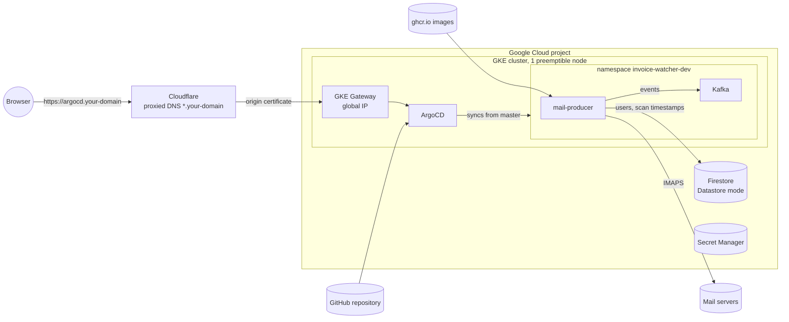
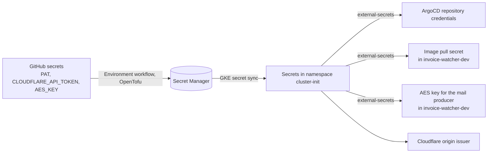
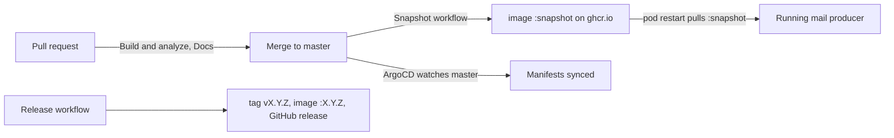

# Architecture

## Applications and libraries

The repository is a Gradle multi-module Java 25 / Spring Boot 4 project with two applications:

| Application | What it is |
|-------------|------------|
| `mail-producer-app` | The service that runs in the cluster: scans mailboxes and publishes events. |
| `secret-helper-app` | A command-line tool for the operator: generates the AES key and encrypts mailbox passwords ([usage](../reference/cli.md)). |

The applications contain almost no code — they put libraries together. Each library area has an
`api` module with interfaces, records and configuration properties, and one or more
implementations that plug themselves in through Spring Boot auto-configuration
([ADR-0003](../adr/0003-put-every-library-behind-an-api-module.md)). Where there is a choice, a
`mode` property picks the implementation:

| Area | Implementations | Selected by |
|------|-----------------|-------------|
| Storage of users | Firestore (Datastore mode), JPA (H2, Cloud SQL) | [`invoice-watcher.mail-producer.dao.mode`](../reference/configuration.md#invoice-watcher-mail-producer-dao) |
| Events | Kafka | [`invoice-watcher.event-producer.mode`](../reference/configuration.md#invoice-watcher-event-producer) |
| Mailbox access | IMAP (Jakarta Mail) | — |
| Secrets | AES-GCM | — |

The full list of modules and their dependencies is generated in [Modules](../reference/modules.md).

## Runtime

In the deployed environment everything runs in one Google Cloud project and one GKE cluster:

- **Cloudflare** holds the domain. A proxied wildcard record points at the gateway's global IP,
  and the gateway serves HTTPS with a Cloudflare origin certificate issued in the cluster.
- **ArgoCD** is the only thing exposed (`https://argocd.<domain>`); the mail producer has no
  HTTP interface for users.
- **Kafka** runs as a single node inside the cluster, without persistent storage.
- **Firestore** keeps users, mailboxes, folders and scan timestamps. The mail producer reaches it
  through workload identity, so there are no service account keys.

### How secrets reach the cluster

No secret is stored in the repository ([ADR-0006](../adr/0006-keep-secrets-out-of-the-repository.md)).
The GitHub token, the Cloudflare token and the AES key are given to the `Environment` workflow as GitHub
secrets; OpenTofu stores them in Secret Manager, and the cluster pulls them from there:

## Delivery

--8<-- "docs/specs/build-and-release.md:pipeline"

Versions come from git tags ([ADR-0005](../adr/0005-derive-versions-from-git-tags.md)); the dev
environment always runs the `snapshot` image. Application manifests are deployed by ArgoCD from
`master` ([ADR-0004](../adr/0004-deploy-applications-with-argocd-from-master.md)) — merging a
change to `deployments/k8s-apps` is the deployment.
