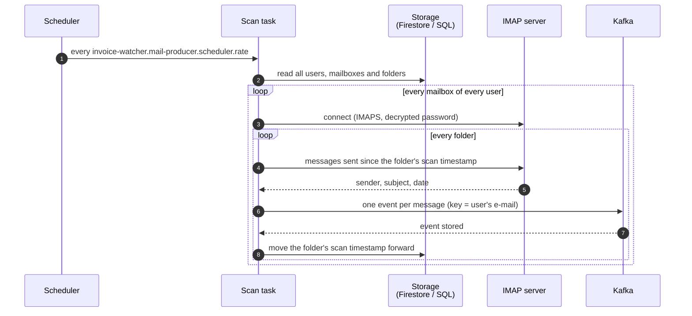
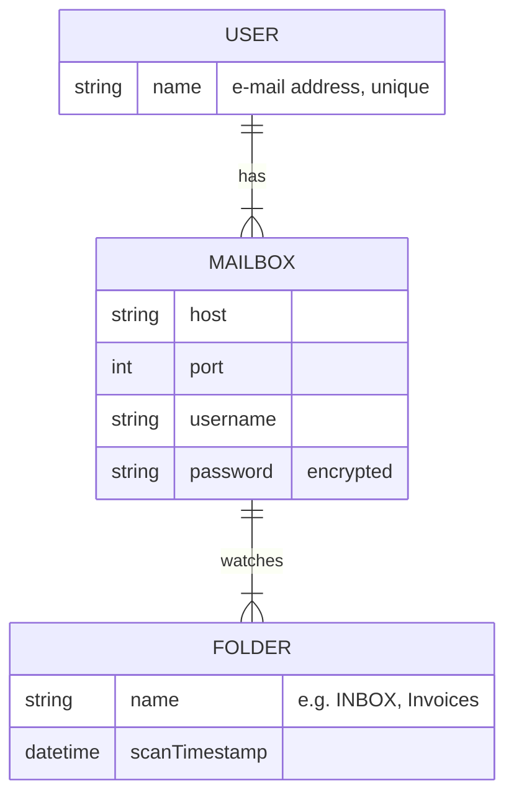

# How it works

InvoiceWatcher does one thing: it reads new e-mails from configured mailbox folders and publishes
each of them as an event to Kafka. Recognising invoices and extracting data from them is left to
consumers of those events — InvoiceWatcher does not know who they are.

This page follows one scan from start to end. The exact rules are in the
[specifications](../specs/index.md); the parts quoted below come from them.

## A scan, end to end

### When scans run

--8<-- "docs/specs/mail-scanning.md:schedule"

### Reaching a mailbox

--8<-- "docs/specs/mail-scanning.md:connection"

### Which messages are picked up

--8<-- "docs/specs/mail-scanning.md:new-messages"

!!! warning "Known gaps"
    Clauses marked *gap* describe intended behaviour the code does not meet yet. Today the most
    visible consequence is that scans publish some messages again; consumers must tolerate
    duplicates anyway (see [event publishing](../specs/event-publishing.md)).

## What InvoiceWatcher needs to know

Users, their mailboxes and folders are stored in a database and read at the start of every scan,
so a change takes effect at the next scan without a restart.

--8<-- "docs/specs/user-configuration.md:model"

The storage is either Firestore in Datastore mode (used in the deployed environment) or a
relational database (used locally with H2) — see [user configuration](../specs/user-configuration.md).
How to add a user is described in [keys and users](../setup/keys-and-users.md).

## What it produces

--8<-- "docs/specs/event-publishing.md:event"

--8<-- "docs/specs/event-publishing.md:delivery"

An example of a published event is shown in [In action](../results/index.md).
