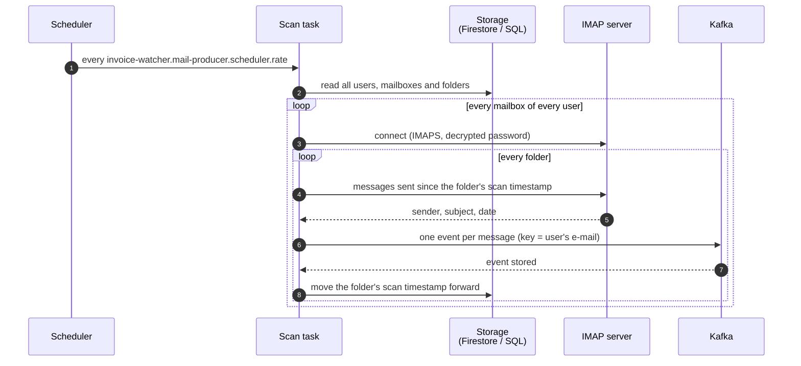
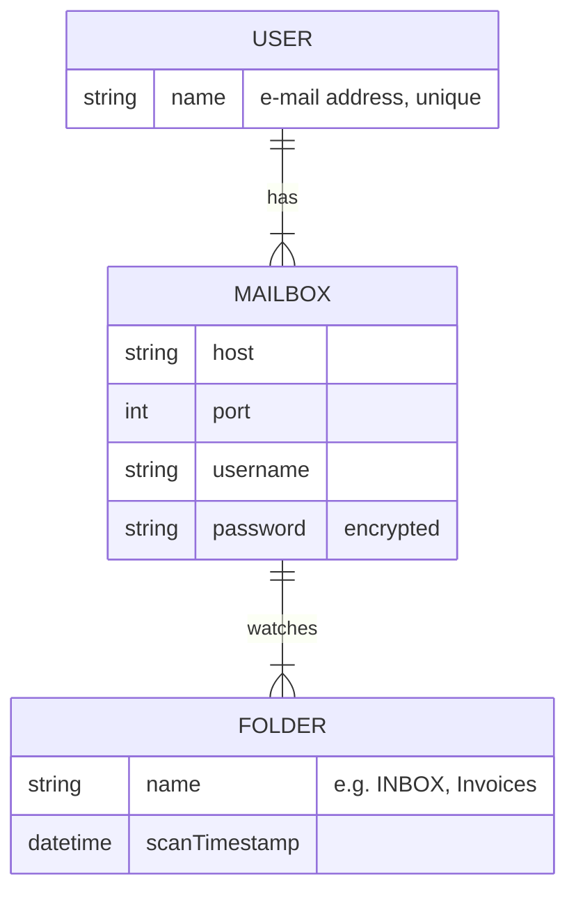

# How it works

InvoiceWatcher does one thing: it reads new e-mails from configured mailbox folders and publishes
each of them as an event to Kafka. Recognising invoices and extracting data from them is left to
consumers of those events — InvoiceWatcher does not know who they are.

This page follows one scan from start to end.

## A scan, end to end

### When scans run

The mail producer scans at a fixed rate — every hour unless
[`invoice-watcher.mail-producer.scheduler`](../reference/configuration.md#invoice-watcher-mail-producer-scheduler)
says otherwise. The first scan starts as soon as the application starts. A scan goes through
every user, every mailbox of that user and every watched folder of that mailbox, one after
another.

### Reaching a mailbox

InvoiceWatcher connects to each mailbox over IMAP with TLS (`imaps`, usually port 993), using the
host and port of the mailbox. It logs in with a username and password. The password is kept
encrypted and is decrypted only for the moment of connecting — see
[keys and users](../setup/keys-and-users.md) for how to encrypt it.

Folders are opened read-only: InvoiceWatcher never marks, moves or deletes your messages.

### Which messages are picked up

Every folder remembers when it was last scanned. A scan picks up the messages sent since that
moment and, once they are published, moves the folder's timestamp forward, so the next scan only
looks at mail that arrived in between. A folder without new messages is left alone.

For every message InvoiceWatcher reads the sender, the subject and the date it was sent.

If a mailbox cannot be reached, or a folder cannot be read, the error is logged and the scan moves
on to the next mailbox. The folder's timestamp stays where it was, so nothing is lost — its
messages are picked up again in the next scan.

!!! warning "Current limitations"
    - The message content is not read yet; events carry only sender, subject and date.
    - After a scan the folder's timestamp moves only to the oldest picked-up message, so later
      scans publish the same messages again. Consumers have to tolerate duplicates anyway (see
      [What it produces](#what-it-produces)).
    - A folder without a scan timestamp cannot be scanned yet, and it stops the folders after it in
      the same mailbox from being scanned. Give every new folder a starting timestamp.

## What InvoiceWatcher needs to know

Users, their mailboxes and folders are stored in a database and read at the start of every scan,
so a change takes effect at the next scan without a restart.

A **user** is identified by their e-mail address and has one or more **mailboxes**. A mailbox
is an IMAP server (host and port) with a username and an encrypted password, and it lists one or
more **folders** to watch — by the name the mail server uses, such as `INBOX`, `Invoices` or
`INBOX/Bills`. Each folder keeps the time it was last scanned; that timestamp is the only thing
InvoiceWatcher itself writes.

The storage is either Firestore in Datastore mode (used in the deployed environment) or a
relational database (used locally with H2), chosen with
[`invoice-watcher.mail-producer.dao.mode`](../reference/configuration.md#invoice-watcher-mail-producer-dao).
How to add a user is described in [keys and users](../setup/keys-and-users.md).

## What it produces

Every picked-up message becomes exactly one event on a single Kafka topic (`all-mails` in the dev
environment), in the order the messages are stored in the folder, oldest first. The event key is
the user's e-mail address, so all events of one user land in the same partition, in order. The
value is a JSON object:

| Field | Type | Content |
|-------|------|---------|
| `sender` | string | The `From` address, e.g. `Shop <billing@shop.example>` |
| `title` | string | Subject |
| `date` | date-time | When the message was sent, in UTC |
| `content` | string | Message content — always `null` for now |

A folder's timestamp moves forward only after Kafka has confirmed every event of that folder. If
an event is not confirmed, the folder counts as failed and its messages are published again in the
next scan — including those already confirmed. Delivery is therefore *at least once*: consumers
must be ready to receive the same message twice.

An example of a published event is shown in [In action](../results/index.md).
