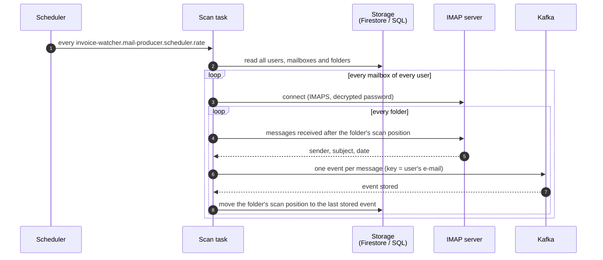
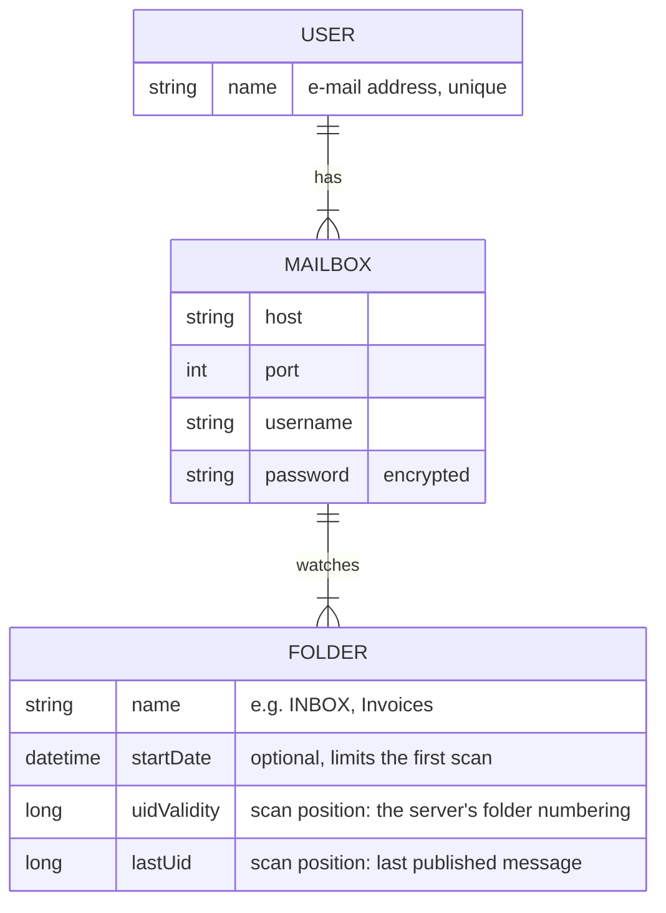

# How it works

InvoiceWatcher does one thing: it reads new e-mails from configured mailbox folders and publishes
each of them as an event to Kafka. Recognising invoices and extracting data from them is left to
consumers of those events — InvoiceWatcher does not know who they are.

This page follows one scan from start to end.

## A scan, end to end

### When scans run

The mail producer scans at a fixed rate — every hour unless
[`invoice-watcher.mail-producer.scheduler`](../reference/configuration.md#invoice-watcher-mail-producer-scheduler)
says otherwise; the rate cannot be shorter than one second. The first scan starts as soon as the
application starts. A scan goes through
every user, every mailbox of that user and every watched folder of that mailbox, one after
another.

### Reaching a mailbox

InvoiceWatcher connects to each mailbox over IMAP with TLS (`imaps`, usually port 993), using the
host and port of the mailbox. It logs in with a username and password. The password is kept
encrypted and is decrypted only for the moment of connecting — see
[keys and users](../setup/keys-and-users.md) for how to encrypt it.

InvoiceWatcher accepts only a trusted certificate issued for the mailbox host, so nobody posing as
the server can capture the password. A server that does not let it connect within 30 seconds, or
stops answering for 60 seconds, ends the attempt (both limits are configurable); such a mailbox is
skipped until the next scan, like any other mailbox it cannot reach.

Folders are opened read-only: InvoiceWatcher never marks, moves or deletes your messages.

### Which messages are picked up

The mail server numbers the messages of a folder in the order it receives them (IMAP UIDs).
Every folder remembers the number of the last message InvoiceWatcher published — its *scan
position*. A scan picks up the messages with a higher number, in the order the server received
them, and once they are published moves the position to the last of them, so the next scan only
looks at mail that arrived in between. The date a sender wrote into a message plays no role: a
message that arrives late with an old date is still picked up. A folder without new messages is
left alone.

A folder that has never been scanned has no position yet. Its first scan picks up the messages the
server received since the folder's start date, or every message in the folder when it has no start
date. If the server renumbers a folder (for example after it was rebuilt), the old position no
longer means anything; InvoiceWatcher notices this and scans the folder as if for the first time.

For every message InvoiceWatcher reads the sender, the subject and the date it was sent. A message
without a sender is still published, without one; a message without a valid sent date gets the
date the server received it instead.

If a mailbox cannot be reached, or a folder cannot be read, the error is logged and the scan moves
on to the next mailbox. If a user's configuration cannot be processed, the scan moves on to the
next user. Each failure is logged once, naming the user, the mailbox host and the folder where it
applies; credentials never appear in the logs. A folder that fails halfway keeps the position of the last message that
was published, so the next scan continues with the first one that was not.

!!! warning "Current limitations"
    - The message content is not read yet; events carry only sender, subject and date.

## What InvoiceWatcher needs to know

Users, their mailboxes and folders are stored in a database and read at the start of every scan,
so a change takes effect at the next scan without a restart.

A **user** is identified by their e-mail address and has one or more **mailboxes**. A mailbox
is an IMAP server (host and port) with a username and an encrypted password, and it lists one or
more **folders** to watch — by the name the mail server uses, such as `INBOX`, `Invoices` or
`INBOX/Bills`. A folder can have a start date that limits its first scan, and it keeps its scan
position; the position is the only thing InvoiceWatcher itself writes.

The storage is either Firestore in Datastore mode (used in the deployed environment) or a
relational database (used locally with H2), chosen with
[`invoice-watcher.mail-producer.dao.mode`](../reference/configuration.md#invoice-watcher-mail-producer-dao).
How to add a user is described in [keys and users](../setup/keys-and-users.md).

The application checks its configuration when it starts. A required property that is missing —
the Kafka brokers, the topic, the encryption key, the database settings of the chosen storage, or
the mock user's details when the mock user is enabled — or a value out of range stops the startup
with a message that names the property. Which properties are required is noted in each
property's description in the [configuration reference](../reference/configuration.md).

## What it produces

Every picked-up message becomes exactly one event on a single Kafka topic (`all-mails` in the dev
environment), in the order the server received the messages, oldest first. The event key is
the user's e-mail address, so all events of one user land in the same partition, in order. The
value is a JSON object:

| Field | Type | Content |
|-------|------|---------|
| `sender` | string | The `From` address, e.g. `Shop <billing@shop.example>`; `null` when the message has none |
| `title` | string | Subject |
| `date` | date-time | When the message was sent, in UTC; when the server received it if the message has no valid sent date |
| `content` | string | Message content — always `null` for now |

A message counts as published once Kafka has confirmed its event. The folder's scan position is
saved once, after every event of the folder is confirmed. If an event is not confirmed, the folder
counts as failed: its position is saved at the last confirmed event and the next scan continues
from there. An event can still be published twice — for example when the application stops after
Kafka confirmed an event but before the position was saved. Delivery is therefore *at least once*:
consumers must be ready to receive the same message twice.

An example of a published event is shown in [In action](../results/index.md).
