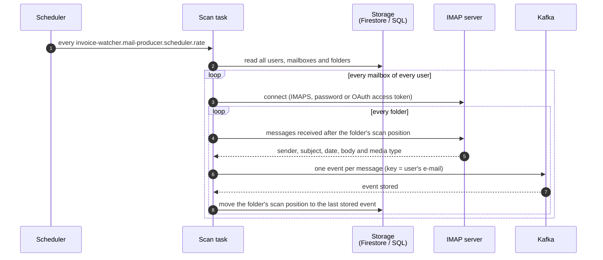
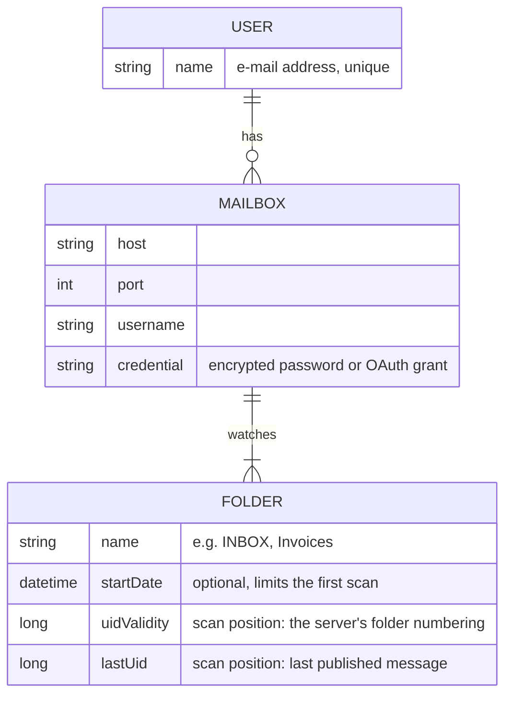

# How it works

InvoiceWatcher does one thing: it reads new e-mails from configured mailbox folders and publishes
each of them as an event to Kafka. Recognising invoices and extracting data from them is left to
consumers of those events — InvoiceWatcher does not know who they are.

This page follows one scan from start to end.

## A scan, end to end

### When scans run

The mail producer scans at a fixed rate — every hour unless
[`invoice-watcher.mail-producer.scheduler`](../reference/configuration.md#invoice-watcher-mail-producer-scheduler)
says otherwise; the rate cannot be shorter than one second. The first scan starts as soon as the
application starts. A scan goes through
every user, every mailbox of that user and every watched folder of that mailbox, one after
another.

### Reaching a mailbox

InvoiceWatcher connects to each mailbox over IMAP with TLS (`imaps`, usually port 993), using the
host and port of the mailbox. It logs in using Gmail OAuth or manually configured username/password credentials. A password is kept
encrypted and is decrypted only for the moment of connecting — see
[keys and users](../setup/keys-and-users.md) for how to encrypt it.

InvoiceWatcher accepts only a trusted certificate issued for the mailbox host, so nobody posing as
the server can capture the password. A server that does not let it connect within 30 seconds, or
stops answering for 60 seconds, ends the attempt (both limits are configurable); such a mailbox is
skipped until the next scan, like any other mailbox it cannot reach.

Folders are opened read-only: InvoiceWatcher never marks, moves or deletes your messages.

### Which messages are picked up

The mail server numbers the messages of a folder in the order it receives them (IMAP UIDs).
Every folder remembers the number of the last message InvoiceWatcher published — its *scan
position*. A scan picks up the messages with a higher number, in the order the server received
them, and once they are published moves the position to the last of them, so the next scan only
looks at mail that arrived in between. The date a sender wrote into a message plays no role: a
message that arrives late with an old date is still picked up. A folder without new messages is
left alone.

A folder that has never been scanned has no position yet. Its first scan picks up the messages the
server received since the folder's start date, or every message in the folder when it has no start
date. If the server renumbers a folder (for example after it was rebuilt), the old position no
longer means anything; InvoiceWatcher notices this and scans the folder as if for the first time.

For every message InvoiceWatcher reads the sender, the subject, the date it was sent, the
message body and its media type. A message without a sender is still published, without one; a
message without a valid sent date gets the date the server received it instead. HTML is preferred
over plain text in multipart alternatives and is preserved without conversion or sanitization
(HTML is untrusted). Related resources, attachments and attached messages are excluded from the body. PDF attachment
evidence is captured separately.
Nested multipart bodies are supported. When no supported body exists the body and media type are
both null; an empty supported body is published as an empty string with its media type. Body
reading or decoding errors fail the folder scan.

If a mailbox cannot be reached, or a folder cannot be read, the error is logged and the scan moves
on to the next mailbox. If a user's configuration cannot be processed, the scan moves on to the
next user. Each failure is logged once, naming the user, the mailbox host and the folder where it
applies; credentials never appear in the logs. A folder that fails halfway keeps the position of the last message that
was published, so the next scan continues with the first one that was not.

## What InvoiceWatcher needs to know

Users, their mailboxes and folders are stored in a database and read at the start of every scan,
so a change takes effect at the next scan without a restart.

A **user** is identified by their e-mail address and has watched **mailboxes**, or none after disconnecting Gmail. A mailbox
is an IMAP server (host and port) with password or Gmail OAuth credentials, and it lists one or
more **folders** to watch — by the name the mail server uses, such as `INBOX`, `Invoices` or
`INBOX/Bills`. A folder can have a start date that limits its first scan, and it keeps its scan
position. The producer writes scan progress and grant-refresh metadata; registration owns
configuration changes.

The storage is either Firestore in Datastore mode (used in the deployed environment) or a
relational database (used locally with H2), chosen with
[`invoice-watcher.user-configuration.dao.mode`](../reference/configuration.md#invoice-watcher-user-configuration-dao).
How to add a user is described in [keys and users](../setup/keys-and-users.md).

The application checks its configuration when it starts. A required property that is missing —
the Kafka brokers, the topic, the encryption key, the database settings of the chosen storage, or
the mock user's details when the mock user is enabled — or a value out of range stops the startup
with a message that names the property. Which properties are required is noted in each
property's description in the [configuration reference](../reference/configuration.md).

## What it produces

Every picked-up message becomes exactly one event on a single Kafka topic (`all-mails` in the dev
environment), in the order the server received the messages, oldest first. The event key is
the user's e-mail address, so all events of one user land in the same partition, in order. The
value is a JSON envelope. `eventType` is `mail.ingested`, and integer `schemaVersion` is `1`.
Together they identify the complete contract, including the payload. The `payload` object
contains:

| Field | Type | Content |
|-------|------|---------|
| `sourceId` | string | Deterministic identity for this message occurrence in this user’s mailbox folder |
| `sender` | string | The `From` address, e.g. `Shop <billing@shop.example>`; `null` when the message has none |
| `title` | string | Subject |
| `date` | date-time | When the message was sent, in UTC; when the server received it if the message has no valid sent date |
| `content` | string | Decoded selected HTML or plain-text body; `null` when none is supported |
| `contentType` | string | `text/html`, `text/plain`, or `null` when none is supported |
| `attachmentManifest` | object | Candidate outcomes, completeness and immutable private PDF references; see [attachment evidence](../setup/mail-attachments.md) |

Other multipart containers select the first supported body in MIME order; alternative bodies are
not concatenated. Consumers must treat HTML as untrusted and sanitize it before displaying it.
Older records may also lack `contentType`.

The source ID starts with `imap-v1:` followed by a SHA-256 digest derived from the owning user,
IMAP host and port, mailbox login, folder, UIDVALIDITY and message UID. Host casing and the
special `INBOX` name are normalized; other names are preserved exactly. Retries, resetting
scan progress, recreating configuration and renewing credentials retain the same identity
when those inputs stay the same. Passwords, tokens and message content never enter the hash.
The identifier does not expose the raw mailbox login, but hashing is not encryption or an
access-control mechanism.

This identifies a message occurrence in a folder. Moving or copying mail to another folder,
changing the mailbox endpoint or account, or a server UIDVALIDITY reset may produce a new ID
for the same logical message. Consumers still need separate business rules to recognize the
same invoice or payment across different messages.

### Event format migration

The envelope is a breaking change from the earlier flat JSON. Update consumers before
rolling out the producer: message fields now live under `payload`, and newly published records
have no Java class-name type headers. Dispatch using `eventType` and `schemaVersion`, ignore
unknown additive fields, and explicitly reject unsupported types or versions.

The configured topic and user key remain the same. Retained flat records are not rewritten;
a replay can therefore contain both formats. Records without an envelope are legacy mail
with no guaranteed source identity. Consumers must handle legacy records explicitly or stop
with an unsupported-format outcome; they must not invent source IDs from content or Kafka
offsets. This change does not dual-publish or automatically backfill historical records.

A message counts as published once Kafka has confirmed its event. The folder's scan position is
saved once, after every event of the folder is confirmed. If an event is not confirmed, the folder
counts as failed: its position is saved at the last confirmed event and the next scan continues
from there. An event can still be published twice — for example when the application stops after
Kafka confirmed an event but before the position was saved. Delivery is therefore *at least once*:
consumers must be ready to receive the same message twice and can use `payload.sourceId`
to deduplicate the same source occurrence. If required source identity inputs are invalid,
the message is not published; the folder fails and its position stops at the last confirmed
event.

An example of a published event is shown in [In action](../results/index.md).

## Self-service Gmail configuration

The registration frontend and backend are separate applications behind the registration HTTPS
origin. Users sign in with Google, explicitly authorize Gmail and choose watched folders. The
backend and producer share one authoritative configuration database and its storage mappings.
Registration owns configuration edits; scanning updates only progress and OAuth grant metadata.
Versioned transactional writes preserve retained folders' progress and reject stale edits.

Gmail uses IMAP with OAuth tokens; manually provisioned username/password mailboxes still work.
Refresh tokens are encrypted at rest. Expired or revoked Gmail access is renewed through consent
during the next sign-in; reconnecting does not rewind scans. See
[registration setup and use](../setup/registration.md).
